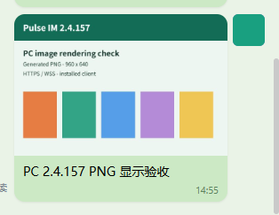

# PC 2.4.157 图片加载修复

日期：2026-11-15。适用分支：`codex/go-rewrite`。发布标签：`pc-v2.4.157`。

## 问题与原因

作者反馈 PC 2.4.156 的图片消息只显示破图图标和文件名。已用原版打包程序连接正式 Go 服务复现，Chromium 给出的决定性错误是：

```text
net::ERR_BLOCKED_BY_RESPONSE.NotSameSite
blockedReason: corp-not-same-site
```

同一个测试图片的缩略图通过 `fetch` 返回 HTTP 200，并能解码；直接嵌入聊天窗口的 `` 则解码失败，`naturalWidth = 0`。服务器的响应带有 `Cross-Origin-Resource-Policy: same-site`，PC 页面来源为 `pulse-app://client`。原代码对原图使用账号隔离的 `pulse-media` 本地通道，却把 `thumbnail_url` 直接放进 HTTPS ``，触发了跨站嵌入限制。

这不是凭截图猜测文件丢失。已在服务器定位到反馈中的同名图片，原图与预览文件均存在。私有排查记录保留具体媒体标识和文件摘要，公开记录不包含访问令牌、有效媒体授权地址或原用户会话。

## 修复内容

- 聊天缩略图与原图都通过既有的账号、会话、消息隔离的本地媒体通道加载。
- 点击缩略图打开完整图片；预览窗口不再把缩略图误当作原图。
- 打开独立预览窗口前重新取得当前有效的 Go 媒体授权，覆盖在聊天停留超过两分钟后再看原图的情况。
- 保留服务器媒体权限和跨站策略。未修改 Go 服务配置、数据库结构或原用户凭据。
- PC 版本升为 `2.4.157`，产生新安装包和新标签，保留旧版本产物用于追溯。

## 验证与复现

本次先在原版 2.4.156 的实际打包程序中复现破图，然后验证修复后的客户端。此前注册、文字收发和断网恢复通过，不能证明最终 PC 安装包中的图片可见；此前记录未提供这条 PC 缩略图渲染链路的验收证据，应以本次补充的图片验证为准。

已完成的源码运行验证：

- 使用独立测试账号，通过正式 HTTPS/WSS 服务和实际选图发送界面发送反馈中的同一张 JPG。
- 聊天中缩略图实际解码为 `611 × 640`，显示来源为 `pulse-media://cache/v1`，没有再触发同站策略拦截。
- 在聊天停留 618 秒后点击，独立预览窗口显示 `932 × 975` 的完整原图，已人工核对截图。
- 客户端 35 项回归测试通过、0 跳过，PC 语法检查通过。新增检查覆盖真实聊天渲染函数的缩略图/原图地址、本地通道传输、重复读取缓存、账号隔离、非受信来源拒绝及账号切换期间取消预览。

最终 NSIS 安装包复验：

| 检查 | 结果 |
| --- | --- |
| 实际安装 | 执行新 NSIS 安装程序，静默安装到独立目录，并从该安装目录启动两个独立账号的 PC 实例 |
| 发送端 | 实际图片发送预览、点击发送；反馈中的同一张 JPG 在聊天中实际显示 `611 × 640` |
| 接收端 | 已打开会话的另一 PC 实例通过正式 WSS 实时接收，图片显示 `611 × 640`，点击显示 `932 × 975` 原图 |
| 授权过期 | 先确认原始旧授权地址已返回 HTTP 401，再点击聊天图片；独立图片窗口仍成功显示完整原图 |
| 另一图片格式 | 使用新生成的 `960 × 640` PNG，经实际选图发送后显示为 `640 × 426` 缩略图 |
| 重启历史 | 关闭并重启实际安装的 PC 程序，重新进入聊天；7 张既有测试图片均成功显示，包括反馈同图和新 PNG |
| 包内完整性 | 安装后的 3,123 个源码/资源文件与当前源码逐字节一致，0 差异；正式 API/WSS 和 `production: true` 均已从安装后的包内复核 |

脱敏验证数据与测试输出见 [证据目录](evidence/pc-image-fix-2026-11-15/summary.json)。下面是安装后客户端实际显示新生成测试图的截图，原用户图片与有效访问授权不进入公开附件：



Windows x64 安装包 SHA-256：

```text
b70d568749a85aa63954e809e1f6fc945304a2f75b4aa3fb4ce29f80447b5229
```

复验命令：

```powershell
node --test client-tests/*.test.cjs
npm --prefix pc run check
```

发布后，作者应安装 `pc-v2.4.157` 的新包，确认自己的实际账号、历史聊天及常用图片格式。旧客户端不会因服务器健康或 GitHub 源码更新自动获得此修复。

## 打包与边界

Windows 构建命令、正式服务地址和签名资料缺项见 [客户端打包交接说明](CLIENT-PACKAGING-HANDOFF-2026-11-15.md)。本次构建使用锁定的 Electron `43.8.10` 本地发行文件，未更换 Electron 版本或依赖锁文件。

PC 包仍未做 Windows Authenticode 代码签名。Android 正式包按用户要求继续暂缓。本次是已复现的 PC 图片链路修复，不能代替所有客户端、全部媒体格式或所有业务功能的完整验收。
