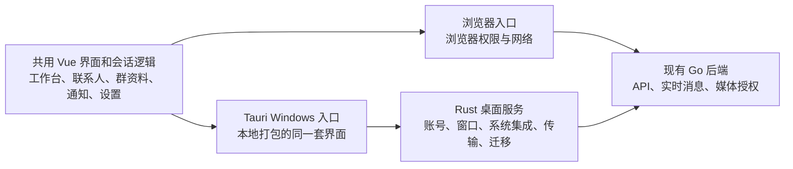

# Pulse IM Windows 客户端 Tauri 重写方案

方案日期为 2026 年 11 月 20 日。目标是用 **Tauri 2 + Rust + WebView2** 替换旧 Electron 桌面运行层，PC 界面直接共用现有 **Vue 3、Vite、TypeScript、Tailwind、Semi 主题和 ProseMirror**。旧 PC 发过的功能、数据、权限、快捷入口和系统行为都有明确的迁移归属，完整验收后才替换正式下载入口。

本次产物是选型、源码基线和验收清单。浏览器对照、Tauri 编译、真实 Windows 安装和上线都属于后续阶段。

- [功能和验收清单](PC-TAURI-PARITY.csv) 已登记 **84 项**。每项包含旧源码入口、计划落点和一个可复现的验收流程。
- [旧端源码基线](PC-TAURI-BASELINE.json) 收录 `pc/` 下 135 个非表情文件、9 个共享模块、6 个 HTML 窗口入口和静态可见的 87 个 IPC 通道。每个文件和通道已关联计划中的验收项。2,997 个表情资源按同一组文件指纹记录。

## 1. 发布过的安装包和当前源码都作基准

| 基准 | 本轮已核对的版本 | 用法 |
| --- | --- | --- |
| GitHub 正式 Windows 安装包 | `pc-v2.4.182`，`25c9ae3` | 复现已发布的入口、设置、权限与升级前数据 |
| GitHub 预发行 Windows 安装包 | `pc-v2.4.192`，`481ced4` | 测较新的快捷键、操作和行为，收录该版用户可能已有的数据 |
| GitHub 当前目标分支 | `codex/go-rewrite`，`4e294f0`，PC 源码 `2.4.194` | 对照两个已发包之后作者和我们在源代码中的新改动 |
| 当前 Web 源码 | `web-vue` 的 `2.4.198` 和待提交图标调整 | 对齐外观、输入、账号切换、通讯录、群成员菜单、通知中心及数据契约 |
| 本地旧 PC 补丁 | `pc/media-disk-cache.cjs` 和对应 `client-tests/pc-media-contracts.test.cjs` | 保留图片通道与慢视频、音频下载分开排队的行为 |

开始实现时，先用实际下载的安装包校验 SHA-256，开一个独立的旧端测试档案，再在相同服务与测试用户下录制两版旧包的功能。实际框架追踪从 `pc/package.json` 到 `pc/main.js`、`pc/window-manager.cjs`、`pc/preload.js` 和 `pc/web/index.html`，包含每个子窗口。遇到旧包、当前源码和菜单文案不同，记录可复现的行为、差异出现在哪一版和应保留的结果。

合并代码及生成候选包前各核对一次 GitHub 分支和旧端变更。作者新增的入口、权限或协议先加到清单，再判断共用、原生迁移或兼容处理。线上用户实际使用的安装包如果另有渠道，将对应文件和版本补入基准。`docs/client-api-coverage.json` 里的 PC 路由表可当索引，它的 Web 路由采集指向旧 `web/`，对照 Vue 端要以 `web-vue/src` 当前调用为准。

## 2. 前端一套代码，桌面运行能力独立

保留 `web-vue` 作为界面与共用业务的权威源，在独立 `pc-tauri/` 目录放桌面入口、桌面专用 Vue 页面和 `src-tauri`。浏览器与桌面分别出构建产物。对当前直连 HTTP、实时、账号状态、剪贴板和下载的调用按需抽出类型明确的适配接口。桌面构建加载包内资源，采用现有 Vue 单文件组件和 `<script setup lang="ts">`。页面样式跟组件走，主题、字体和线性图标使用同一份资源。桌面窗口权限按用途配置，例如大图窗口只需要图片查看和复制。涉及网络和落盘的操作由 Rust 或经过验证的原生能力执行，页面不接收任意路径、任意下载地址或其他账号的会话凭据。

| 界面或模块 | 直接共用 | PC 落点 |
| --- | --- | --- |
| 登录、验证码、二步验证、多账号面板 | `AuthView.vue`、`CredentialsForm.vue`、`AccountsDialog.vue`、`useSession.ts` | Windows 记住账号、已打开账号窗口、锁屏、独立窗口组和版本上报 |
| 主界面、会话侧栏、顶部和右栏 | `ChatWorkspace.vue`、`ConversationHeader.vue`、`ConversationSidebar.vue`、`GroupSidebar.vue`、`useChat.ts` | 首屏和历史恢复、窗口状态、分组、实际窗口快捷键及独立会话 |
| 输入、消息操作和媒体 | `MessageComposer.vue`、`ComposerEditor.vue`、`MessageList.vue`、`MessageActions.vue` | 真文件拖放、剪贴板、双屏截图、原图、Native 上传下载、独立图片和历史窗口 |
| 联系人、群、通知和任务 | `ContactsPanel.vue`、`GroupDialog.vue`、`GroupMemberMenu.vue`、`NotificationCenter.vue`、`BroadcastPanel.vue` | 各角色动作、旧入口细节、托盘通知和任务中心的后台行为 |
| 设置与系统菜单 | `SettingsDialog.vue`、`AdvancedSettings.vue`、通知和隐私组件 | 代理、线路、缓存、导出、日志、设备选择、字体缩放、开机启动、更新及发送到菜单 |

宽窗沿用 Web 的左侧导航和会话列表、单个会话顶栏、会话内容及右侧常驻群资料。群资料和管理按标签分开，右栏成员菜单与群管理复用同一套权限和动作。输入区保留线性工具栏、同排发送键和可被光标删除的行内附件卡片。窄窗口按现有 Web 的响应行为收起资料栏。标题栏、独立窗口、通知和托盘采用同一视觉主题，保留 Windows 拖窗、缩放、任务栏及键盘习惯。桌面专用能力通过对应的现有菜单进入。

在 Vue 侧，组件接收会话、账号和状态作为类型化参数，向上发出 `selectConversation`、`sendDraft`、`memberAction` 等事件。会话层处理切换、加载和业务更新，平台层只负责桌面动作。主窗口和副窗口按账号隔离，主服务以实际窗口标识、会话代次和账号验证请求来源。销毁窗口或切账号时注销订阅、取消失效请求。大图或进度经按任务授权的资源引用和有界事件传递，文件上传或下载流式读写。

## 3. 先跑通最容易卡住的原生能力

| 必须实际做通的链路 | 要证实的行为 | 实施决定 |
| --- | --- | --- |
| 两账号加会话子窗口 | A/B 同时收消息，切换、锁屏、托盘及通知点开各自内容，退出 A 后 B 继续在线 | 确认 WebView2 的数据目录或 Profile 隔离可用。Rust 账号存储、窗口权限和请求仍独立校验 |
| 代理和线路 | 官方线路签名及超时处理继续工作。直连、系统代理、HTTP/HTTPS、SOCKS4 和 SOCKS5/5h 的 API、WS、媒体出口一致 | 原生网络客户端统一代理策略，验证 DNS 行为、IPv6、代理认证和失败回滚。若库缺旧代理类型，补相应适配再进候选 |
| 文件和截图 | 从资源管理器拖文件，剪贴板图像粘贴，双显示器不同 DPI 框选，发送出去可收到 | 文件输入走实际选择或拖放授权。选区以显示器坐标和缩放比例转换。用一个事件入口分发落点，验证拖放事件与编辑器不会处理两次 |
| 历史和待发消息迁移 | 从旧档导入资料，正在发送或离线的文字不会重复发，旧包可继续打开备份 | 先在旧运行时对其可读取的数据做版本化转换，再在新端校验身份和授权后导入 |
| 安装、通知和更新 | 旧快捷方式、开机启动和通知点击定位可靠，旧包能打开正确的下载入口 | 先出隔离的 NSIS x64 开发包，在 Windows 10/11 验证旧/新安装方式、WebView2 Runtime 和签名 |

正式启动后，继续按现行协议上报桌面平台、真实包版本及必要设备信息。联网诊断采集的是客户端出口。建立同一账号的实时序列、去重和补拉策略，弱网、恢复前台、系统睡眠及账号切换时重新确认边界。上传、下载、截图编解码、磁盘和重试放后台执行。媒体队列与聊天分开，两类下载槽继续独立，合并重复媒体授权和群成员请求。授权图片按稳定资源 ID 与账号缓存，签名变化时更新授权，不触发整列消息重挂。

## 4. 旧资料导入、安装和恢复

- 旧档案包含 `account-profiles.json`、`application-settings.json`、`chat-typography.json`、`proxy-settings.json`、账号窗口组记忆文件、IndexedDB 内的加密历史和待发消息，以及下载与媒体缓存。盘点时要记录数据由谁拥有、是否可以重建、导入有无副作用、哪一个旧包能读取。
- 候选包使用单独的应用身份和数据目录。用同一 Windows 用户下的测试档案在两个旧发行包上分别演练。Electron 和 WebView2 的存储来源及加密密钥处理方式不同，先验证旧应用内可读取的记录，再走受信的一次性迁移。长期凭据使用 Windows 保护。迁移时应用设置、账号分组、草稿、历史及待发文字都有结果记录，记录只保留状态与条数。若旧会话无法安全转移，给相应账号重新登录入口，按原账号和后端身份恢复其资料。
- 首次导入写入新档案并原子提交。验证重复导入、迁移中断、账号重新授权和清理权限相关缓存。待发消息以原 `request_id` 恢复，导出和回退窗口会暂停同一账号的重复派发，校验服务端幂等。已下载文件继续留在原位置。可以重建的头像、媒体缓存先核对清理和授权范围。
- 初期保留官方 Windows x64 NSIS 分发方式。预览包走独立下载和身份，正式包结合旧产品标识、快捷方式、注册项、WebView2 分发方式与签名，在目标 Windows 版本跑一遍安装、重启、覆盖、修复和卸载之后再决定是否同标识覆盖。签名安装程序和更新签名分别验收。
- Go 最低版本门槛和旧包检查更新契约继续支持。正式切换即使发生回退，旧版下载、读取旧资料和重新登录要可用。灰度在独立候选通道，确认真实安装与更新后才提高最低版本。如已签名升级无法原地降级，提供签名的回退安装流程与旧档案恢复，演练后写入发布记录。

## 5. 逐文件对照和正式发布检查

每项功能从旧用户真正进入的位置开始。记录**菜单或快捷键 → 角色和开关 → 旧处理函数 → 旧平台或 Go 接口 → 数据和界面结果**。再填写新组件、Rust 命令或共用接口及真实结果。对照从启动到退出全部窗口，包含等待、失败、取消、重复点击、通知跳转、断网恢复和账号切换。每个旧文件及 IPC 通道都需登记到功能 ID 或资源 ID。动态菜单、事件监听和生成配置按运行时另采，不依赖静态提取的 87 个通道。

用 CSV 记录 `待核实旧包`、`待迁移`、`已实现待验收`、`已验收`。标为 `已验收` 必须有新旧代码对照、实际候选 `commit`、操作结果和 Windows 包证据。旧包的空态或禁用项也要有源码和实测依据，例如通话记录的空态及媒体设备入口、旧投票消息显示方式。仅 Web 样式变化会单独看共用 UI 的回归。发现一项新增行为就新增或拆分对应行，保持 ID 可追溯。

| 发布检查 | 通过条件 |
| --- | --- |
| 清单完整 | 旧安装版、当前源代码和生效配置中每项入口、后台动作和数据均有映射，所有文件和通道均有归属。候选没有缺失或仅有空按钮的功能 |
| 手工对照 | 在真实 Windows 候选安装包走完矩阵。覆盖普通用户、群主、管理员、内部员工、多账号、前后台、同机不同 DPI、键盘和鼠标。记录版本、前置状态、实际结果及证据位置 |
| 自动回归 | 保留 Go 契约、旧用户报错路径、队列与迁移的自动断言。Web 继续走现有回归，桌面用 Windows WebDriver 辅助，不以自动回归代替逐文件核对或原生行为 |
| 体感和耗时 | 同机、同数据、同网络并排跑旧包与候选。在小群和大群测打开会话到首条消息、发文字到对端可见、选图到出现进度和到对端可见、群成员首屏、批量媒体下文字时延。区分冷/热缓存，记录 P50、P95、UI 长任务、CPU、内存和失败率。核心路径不得有经复测仍存在的可感知退化 |
| 本地数据与平台 | 预览安装、覆盖演练、旧档案导入和可恢复回退都通过。账号隔离、卸载范围、签名和强更路径符合实测结果 |
| 发布身份 | 只发布通过上述检查的同一提交及同一 SHA-256 的候选包。灰度验收身份和日志可定位，出现丢消息、账号串数据、无法登录、打不开会话或不能上传时立即暂停切换 |

以 `CHAT-07` 独立历史窗口为例，从 [`openDetachedChatHistory`](../pc/web/app.js#L1247) 到 `pulse:open-history-window`，再追到 [`pulse:history-window:page`](../pc/history-window.cjs#L64)。新旧对照要分别记录窗口入口、历史翻页与媒体动作、消息撤回同步，以及锁屏或退出时的权限回收。只通过主窗聊天搜索不会满足这一项。

把这些条件接入正式打包入口。检查矩阵状态、缺证据项、变更导致的基线漂移和候选文件摘要。允许独立构建开发预览，正式签名、发布到 GitHub 正式通道、切下载地址与更改最低版本使用同一验收记录。状态报告分别写已完成阶段、未通过项目和对应版本。

## 6. 施工顺序和每阶段交付

1. **冻结旧端行为。** 校验旧安装包，做独立档，逐菜单、资料页、右键动作、设置、标题栏和托盘录像。补齐清单的运行时入口、版本差异、全部文件与 IPC 映射，并注明旧 Web 和 Vue 的接口差异。交付旧端可复现基线。
2. **验证 Tauri 底座。** 做独立预览壳，跑通双账号、代理、剪贴板和多屏截图、离线档案导入和 NSIS 安装。交付 Windows 验证包和结果，有缺口继续解决。
3. **共用界面并逐组迁移业务。** 先做登录、会话、文本、历史和实时恢复，再做附件、群成员、联系人、通知和任务，最后接全设置、系统功能及数据导入。每组完成后立即更新旧、新代码映射和实际操作结果。维护浏览器端现有输入交互和样式。
4. **安装包验收。** 在同一设备和测试数据上比较旧包与新包，做多角色、双账号、跨端收发、弱网、休眠、大群和同时传输验证，再演练旧档导入及恢复。交付矩阵、性能记录、候选包和哈希。
5. **发布。** 先发独立候选通道，再依据真实用户的安装、登录、会话、文字和媒体结果放量。发布同一候选文件，更新正式下载入口及说明，记录能恢复旧包的版本和步骤。

Tauri 配置和发布约束以官方文档为准。参考 [Vite 集成](https://v2.tauri.app/start/frontend/vite/)、[窗口权限](https://v2.tauri.app/security/capabilities/)、[Windows 安装](https://v2.tauri.app/distribute/windows-installer/)、[Windows 签名](https://v2.tauri.app/distribute/sign/windows/)、[更新](https://v2.tauri.app/plugin/updater/) 和 [Windows 桌面自动化](https://v2.tauri.app/develop/tests/webdriver/)。
